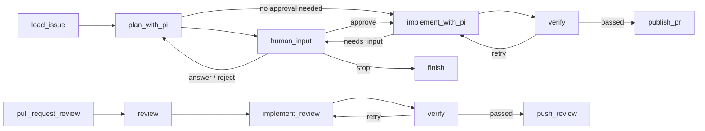

# Coding Agent Graph

A coding agent driven by GitHub Issue comments. FastAPI receives webhooks, LangGraph runs the workflow and its pauses, Pi explores and edits the code in a dedicated workspace, and SQLite stores checkpoints and metadata.

## Daily use (quick start)

Once installation and the one-time setup (below) are done, this is how you work with the agent.

**1. Start the server** (first terminal):

```powershell
cd coding-agent-graph
.venv\Scripts\python.exe -m uvicorn main:app --host 0.0.0.0 --port 8000
```

The server is ready when it prints `Uvicorn running on http://0.0.0.0:8000`. Don't use `--reload`. After a code change, stop it (`Ctrl+C`) and start it again.

**2. Expose it to GitHub** (second terminal), with either of these:

```powershell
& "C:\Program Files (x86)\cloudflared\cloudflared.exe" tunnel --url http://localhost:8000
ngrok http 8000
```

The printed address, followed by `/webhooks/github`, is the webhook's Payload URL in GitHub (see [Connecting GitHub](#connecting-github)). With cloudflared and free ngrok the address changes on every start, so update it in GitHub each time.

**3. Give it a task:** open an Issue in the repository and comment `/agent start`. The agent reacts with 👍 and starts.

**4. Follow along:** open http://localhost:8000/dashboard to see the flow, the comments and the costs in real time.

**5. Respond when needed:**

| The agent wrote | You reply |
|---|---|
| "Proposed plan … Why approval is needed" | `/agent approve`, or `/agent reject <reason>` |
| "Agent needs input" | `/agent answer <text>` |
| "Pull request ready for review" | Review the PR. Request changes or Comment starts another fix round |

**6. Merge the PR yourself.** The agent deletes the sandbox and the run closes. `/agent stop` stops a run at any point.

## Workflow



Pi plans with read and search tools only. Once the plan is approved it gets edit and shell tools inside the workspace. The service itself checks the diff and runs `npm run lint` and `npm run build`; Pi gets no GitHub credentials and never pushes on its own. After successful verification the service commits, pushes and opens a PR automatically.

When a review of type **Request changes** or **Comment** is submitted, the service loads the review summary and its inline comments, hands them to Pi in the same workspace and session, verifies the fixes and pushes another commit to the same PR. An **Approve** review changes no code, and merging stays manual.

### Plan approval

`REQUIRE_PLAN_APPROVAL` decides when a plan waits for `/agent approve`:

| Value | When the agent waits for approval |
|---|---|
| `true` (default) | Always |
| `auto` | Only when the change is complex. Pi rates every plan `simple` or `complex` and explains why. A `simple` plan with at most `AUTO_APPROVE_MAX_STEPS` steps (default 4) runs immediately; everything else waits for approval |
| `false` | Never |

`complex` means several features or requirements, changes across several areas of the code, a new dependency, a change to the data or storage format, removed behavior, or a product decision a person would want to weigh in on. When in doubt, Pi rates it `complex`. The step limit is enforced in code, so a long plan stops even if Pi rated it `simple`.

When a plan runs without approval, it is posted as an informational comment with the reason, and the PR remains the checkpoint. When it waits, the comment explains why approval is needed. In every mode, if something is unclear, Pi asks a question (`needs_input`) and the run waits for the answer. `/agent start auto` skips approval for a single run. If the code already meets the issue's requirements, Pi returns `no_changes`: the run ends with status `no_changes` and a comment explaining where it is already implemented, without asking for approval or retrying. An implementation that leaves no diff ends the same way.

### Structured results from Pi

Pi ends every phase by calling the `submit_result` tool ([pi_extensions/submit_result.ts](pi_extensions/submit_result.ts)), loaded with `--extension`. Pi enforces the schema, the allowed statuses depend on the phase (`ready|needs_input|no_changes|failed` while planning, `completed|needs_input|no_changes|failed` while implementing), and the tool returns `terminate: true` so there is no extra LLM turn. While planning, the result also carries `complexity` and `complexity_reason`. The service reads the result from the `tool_execution_end` event instead of extracting JSON from free text; text extraction remains only as a fallback for models that don't call the tool.

## Installation

Requires Python 3.11+, Node.js, Git and Pi.

```bash
npm install -g @earendil-works/pi-coding-agent

cd coding-agent-graph
python -m venv .venv
# Windows: .venv\Scripts\activate
# macOS/Linux: source .venv/bin/activate
pip install -r requirements.txt

cp .env.example .env
python -m uvicorn main:app --host 0.0.0.0 --port 8000
```

Don't run the agent server with `--reload`: SQLite checkpoints and workspaces change local files, and WatchFiles may restart the server and kill the worker mid-run. After a code change, stop and restart the server by hand.

On Windows with several Python versions installed, create the environment with `py -3.13 -m venv .venv`.

Set these in `.env`. Every variable is explained by a comment in [.env.example](.env.example), with its default and the mode it applies to.

- `GITHUB_TOKEN`: reads Issues, writes comments and opens PRs. In local mode it also pushes; in cloud mode the sandbox pushes with the `github` cloud secret instead. If empty, the service uses `GH_TOKEN`, then the local token from `gh auth token`. The token is not validated up front.
- `GITHUB_WEBHOOK_SECRET` and `WEBHOOK_VERIFY_SIGNATURE`: see [Webhook signatures](#webhook-signatures).
- `AUTHORIZED_GITHUB_USERS`: comma-separated list of users allowed to command the agent.
- `OPENROUTER_API_KEY`: passed only to the Pi process in local mode. In cloud mode the key lives in Docker's secret store instead.
- `OPENROUTER_MODEL`: defaults to `z-ai/glm-5.3`.
- `REQUIRE_PLAN_APPROVAL` and `AUTO_APPROVE_MAX_STEPS`: see [Plan approval](#plan-approval).

### Tracing the graph with Langfuse

To see every run as a trace, with the node order, inputs and outputs, timings and errors, create a Langfuse project and add to `.env`:

```dotenv
LANGFUSE_PUBLIC_KEY=pk-lf-...
LANGFUSE_SECRET_KEY=sk-lf-...
LANGFUSE_BASE_URL=https://cloud.langfuse.com
LANGFUSE_TRACING_ENVIRONMENT=development
LANGFUSE_TRACING_ENABLED=true
```

Restart the server, run `/agent start`, and open **Tracing → Traces** in Langfuse. Each invocation or resume of the graph appears as `coding-agent:<action>`, and all the pieces of one run are grouped under a session equal to the `run_id`. You can also filter by `repository`, `issue_number`, `action` and the `coding-agent-graph` tag.

If the keys are not set, Langfuse is off and the service works unchanged. Set `LANGFUSE_TRACING_ENABLED=false` to disable it explicitly. Note that Langfuse receives the graph state, including the Issue content, the plan and human decisions; pick a hosting option and retention policy that fit how sensitive your data is.

### Webhook signatures

Every webhook is checked against `GITHUB_WEBHOOK_SECRET`: the server computes an HMAC-SHA256 of the request body and compares it to the `X-Hub-Signature-256` header. A missing or wrong signature returns `401`. If no secret is configured, the server refuses every webhook (`500`), so nobody can forge a payload in an authorized user's name.

To set it up:

1. Generate a secret: `python -c "import secrets; print(secrets.token_hex(32))"`.
2. Put it in `.env` as `GITHUB_WEBHOOK_SECRET=<secret>`, with `WEBHOOK_VERIFY_SIGNATURE=true`.
3. In GitHub, open **Settings → Webhooks →** your webhook **→ Edit**, paste the same value into **Secret** and click **Update webhook**. GitHub never shows a saved secret again, so keep it in `.env`.
4. Restart the server. Under **Recent Deliveries**, **Redeliver** an old delivery: `202` means the secrets match, `401` means they don't.

The `WEBHOOK_VERIFY_SIGNATURE` flag controls the check. It is on by default and when the variable is empty; `false`, `off`, `0` and `no` turn it off. With the check off, the server accepts any webhook without a signature or a secret and logs a warning on startup. The tunnel is public, so in this mode anyone who knows the address can send a command as an authorized user. Use it only during development, and turn it back on before exposing the server for real.

The remaining defaults are documented in `.env.example`. LangGraph state, requests, tool events, workspaces and Pi sessions are stored under `.agent-data` and are not committed to Git.

The webhook queue is stored in SQLite as well. The server returns `accepted` only after the work item is saved, and after a restart it puts items in `queued` or `processing` state back on the queue. An unexpected failure is retried up to three times before the item is marked `failed`, so a restart in the middle of a review doesn't require a new comment.

## Running in the cloud (Docker Cloud Sandboxes)

With `EXECUTION_MODE=cloud` in `.env`, Pi and the commands on the code run in a [Docker Cloud Sandbox](https://docs.docker.com/ai/sandboxes/cloud/) instead of on the local machine. Each run gets its own sandbox named `agent-issue-<N>-<run>`, created from the official Pi Kit ([`docker.io/docker/sbx-kit-pi`](https://github.com/docker/sbx-kits-contrib/tree/v3/pi), Kit v3).

Inside the sandbox, [sandbox/agent.sh](sandbox/agent.sh) clones the repository, creates the branch and runs Pi. It then runs `npm ci`, `npm run lint` and `npm run build`, and finally commits and pushes. The service decides when to push: only after the checks pass. It then opens the PR as in local mode. Pi's events stream back through `sbx exec`, so `pi_logs.py`, Langfuse, the dashboard and the Issue comments work unchanged.

**Keys never enter the sandbox.** They live in Docker's secret store, and the sandbox proxy adds them to outgoing requests. Inside the sandbox there are only placeholder values. The network is blocked by default (`deny-all`); only what the Kit declares, plus `SANDBOX_ALLOW_NETWORK`, is allowed.

### One-time setup

```bash
# Windows: winget install -h Docker.sbx
sbx login
sbx --cloud diagnose                        # every line should show ✓

sbx --cloud secret set github               # token with Contents: Read and write on the repository
sbx --cloud secret set-custom --name openrouter --host openrouter.ai --env OPENROUTER_API_KEY
```

OpenRouter is not a built-in cloud service, so it is stored as a custom secret: the proxy adds `Authorization: Bearer <key>` to requests to `openrouter.ai`. The sandbox also uses the GitHub token to push, so use a fine-grained PAT scoped to this repository only, together with branch protection on `main`.

### Sandbox lifecycle

- The sandbox is created with `--ttl 24h --on-timeout stop`. When the time runs out it is stopped, not deleted, and a stopped sandbox costs nothing.
- `sbx exec` restarts a stopped sandbox in about 2 seconds. Files and the Pi session are kept, so waiting for an approval or a review resumes from the same point.
- `/agent stop` also stops Pi running inside the sandbox.
- While the service waits for an answer or a review, the sandbox is stopped and costs nothing.
- When the PR is merged or closed, the service deletes the sandbox (in local mode: the worktree) and marks the run `merged` or `closed`. For this the webhook must also include **Pull requests** events. Manual cleanup: `sbx --cloud ls`, then `sbx --cloud rm <name>`.

### Inspecting by hand

```bash
sbx --cloud ls                                   # running and stopped sandboxes
sbx --cloud exec -it agent-issue-12-ab12cd34 bash # look around, files and git diff
sbx --cloud policy log agent-issue-12-ab12cd34   # blocked network requests
```

## Connecting GitHub

Expose the server through a tunnel, for example:

```bash
ngrok http 8000
```

In the repository, open **Settings → Webhooks → Add webhook** and set:

- Payload URL: `https://<tunnel-host>/webhooks/github`
- Content type: `application/json`
- Secret: the same value as `GITHUB_WEBHOOK_SECRET` in `.env` (required, unless `WEBHOOK_VERIFY_SIGNATURE=false`)
- Events: **Issue comments**, **Pull request reviews**, **Pull request review comments** (for inline comments on the dashboard) and **Pull requests** (for cleanup after merging)

## Live dashboard

The server serves a dashboard at `/dashboard`. It shows every issue and PR, the flow (Triggered → Plan → Approval → Implement → Verify → PR → Review → Done) with the duration and cost of each stage, a cost breakdown per phase, and a timeline of every comment, command, approval and Pi session, down to each tool call. Each review round appears separately. Updates arrive in real time over Server-Sent Events (`/api/stream`).

All data is read from SQLite. GitHub comments are stored in the `comments` table: the agent's own comments when it posts them, everything else (including reviews and inline comments) from the webhook. On startup the server also pulls the comments and titles of recent runs from GitHub, so history shows up too.

To browse without running the agent (read-only from the database, `/graph` included):

```bash
python dashboard.py --backfill    # pull comments and titles from GitHub, then serve on http://127.0.0.1:8090/dashboard
python dashboard.py               # without pulling from GitHub
```

If the server is exposed through a tunnel, the dashboard and its API are exposed too, with no authentication.

## Key events and Telegram

[events.py](events.py) collects each run's key events: started; sandbox created, started, stopped or deleted; Docker retries; plan; question awaiting an answer; checks passed or failed; PR opened; review fixes; finished; and PR closed. Every event is stored in the SQLite `events` table and shows up in the server log:

```bash
python events.py                      # recent events
python events.py --follow             # follow live
python events.py --run-id d83d7e04    # one run's timeline
```

If both `TELEGRAM_BOT_TOKEN` and `TELEGRAM_CHAT_ID` are set, events are also sent to a Telegram group, with one Topic per Issue. If either is missing, Telegram is off. Delivery runs in a background queue: a Telegram outage or rate limit never blocks or slows a run, and the event stays in SQLite either way. If the group has no Topics, or the bot may not manage them, messages go to the main chat. Issue content and plans reach Telegram; tokens and keys are redacted.

**Group setup:**
1. In [@BotFather](https://t.me/BotFather): `/newbot`. The token goes to `TELEGRAM_BOT_TOKEN`.
2. Create a group and enable **Topics** in its settings (Edit).
3. Add the bot to the group and make it an **Admin** with the **Manage Topics** permission.
4. Send any message in the group and open `https://api.telegram.org/bot<TOKEN>/getUpdates`. The `chat.id` value (a number starting with `-100`) goes to `TELEGRAM_CHAT_ID`.

## Following Pi

While the server runs, Pi's events appear directly in the `uvicorn` console:

```text
INFO pi [run=12ab34cd phase=plan] tool start: read {"path":"todo-app/src/App.tsx"}
INFO pi [run=12ab34cd phase=plan] tool end: read status=ok ...
INFO pi [run=12ab34cd phase=implement] tool start: bash {"command":"npm run lint"}
INFO pi [run=12ab34cd phase=implement] assistant: {"status":"completed",...}
```

All events are also stored in SQLite. To show the history:

```bash
python pi_logs.py
```

To follow live, like `tail -f`:

```bash
python pi_logs.py --follow
```

Filter by the run ID shown in the Issue comments and the log:

```bash
python pi_logs.py --follow --run-id 12ab34cd
```

`LOG_LEVEL=INFO` shows the start and end of every tool and Pi's replies. `LOG_LEVEL=DEBUG` also shows intermediate updates from long-running tools. Payloads are stored after redacting sensitive fields and known key values.

## Issue commands

```text
/agent start
/agent start auto
/agent answer [request-id] <text>
/agent approve [request-id]
/agent reject [request-id] <reason>
/agent stop
```

The request ID is optional: without it, the command goes to the pending request of the Issue's active run (each Issue has at most one pending request).

There is no `/agent publish`: after successful verification a PR is opened automatically (not as a draft). The PR number is stored in SQLite and links future reviews to the same run. Only reviews from users listed in `AUTHORIZED_GITHUB_USERS` enter the work queue. Merging stays manual.

## Tests

```bash
pip install -r requirements-dev.txt
pytest
```

The tests cover webhook intake and signatures, authorization, duplicate deliveries, stale approvals, persistence and resume after a restart, opening a PR, storing the PR number, review intake, stopping, Pi failures, repository check failures, plan approval modes, and the dashboard's timeline, costs and review rounds. [tests/test_cloud_sandbox.py](tests/test_cloud_sandbox.py) covers cloud mode with a fake `sbx`: creating a sandbox with a TTL and network policy, cloning the branch, running Pi through `sbx exec`, checks and push inside the sandbox, and retrying while a sandbox is still stopping.
