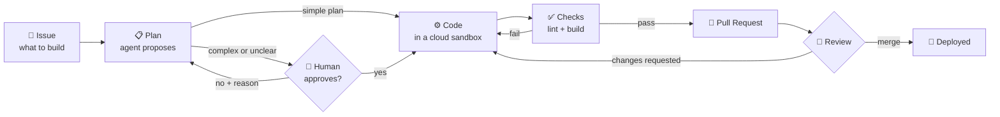

# 1. Overview

> **In one sentence:** write an Issue, comment `/agent start`, and get a Pull Request that passed the checks.

## The idea

Most AI coding tools work inside one developer's editor. This agent works where the team already manages its work, which is GitHub:

- **The task** is an Issue.
- **The conversation** with the agent happens in comments on the Issue.
- **The output** is a regular Pull Request that goes through review and merge like any other code.

## Three principles

1. **People decide, the agent executes.** There are two human checkpoints: approving the plan before any code is written, and reviewing the PR before it is merged. In `auto` mode the agent skips the approval only for simple changes, and stops when a change is complex or unclear. Merging is always manual.
2. **The agent gets no keys.** It runs in a cloud sandbox with no GitHub token and no API key. Secrets are added to requests at the network level, out of its reach.
3. **Checks, not promises.** The server doesn't trust what the agent says it checked. It runs the checks itself, and a PR is opened only if they pass.

## What's in the project

| Part | What it is |
|------|------------|
| `todo-app/` | The React app the agent works on in the demo. Published to GitHub Pages on every merge to `main`. |
| `coding-agent-graph/` | The agent: a FastAPI server, a LangGraph graph, running Pi and managing sandboxes. |
| `docs/` | This documentation. |

## Technologies

| Role | Tool |
|------|------|
| Receiving GitHub events | FastAPI + webhooks |
| Running the workflow, its pauses and resumes | LangGraph with checkpoints in SQLite |
| The agent that reads and writes code | Pi (coding agent) via OpenRouter |
| Isolated runtime | Docker Cloud Sandboxes (`sbx --cloud`) |
| Notifications | Telegram, with one Topic per Issue |
| Tracing | Langfuse |
| Live view of every run, its comments and costs | Dashboard at `/dashboard`, read from SQLite |
