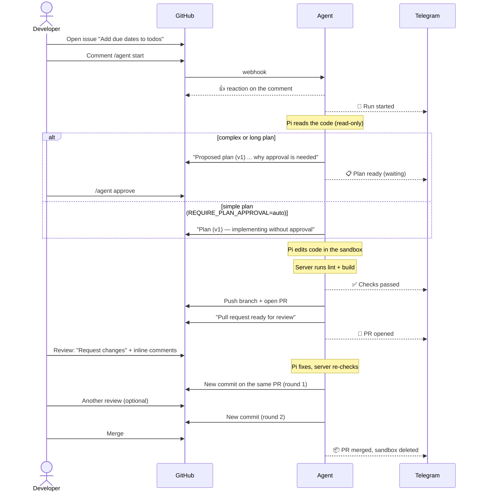
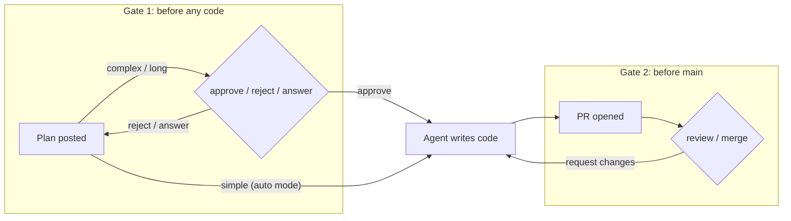

# 2. User journey

> **What the user sees:** everything happens in comments on the Issue and the PR. There is no extra interface to learn. For the full picture, open the dashboard at `/dashboard` ([08](08-observability.md)).

## The full path

## Commands

Every command is a comment on the Issue. Only users listed in `AUTHORIZED_GITHUB_USERS` can command the agent.

| Command | When | What happens |
|---------|------|--------------|
| `/agent start` | On a new Issue | Opens a run: planning, then approval according to `REQUIRE_PLAN_APPROVAL` (see below) |
| `/agent start auto` | When you trust the agent with the task | Skips plan approval. Clarifying questions still stop the run |
| `/agent approve` | After the plan is posted | Starts writing code |
| `/agent reject <reason>` | The plan is wrong | The agent re-plans with the reason |
| `/agent answer <text>` | The agent asked a question | The answer is added to the decisions, and the agent continues |
| `/agent stop` | At any point | Stops the run, including Pi if it is running |

`approve`, `answer` and `reject` accept a request ID (for example `/agent approve a1b2c3d4-p1-a`). Without one, the command goes to the request pending on the Issue.

## The two human decision points

- **Gate 1** saves time: if the agent misunderstood, you stop it before it writes code. When the gate applies is set by `REQUIRE_PLAN_APPROVAL` (see below). `/agent start auto` skips it for one run and relies on gate 2.
- **Gate 2** always applies: the agent never merges. Reviews are also taken only from authorized users.

## When the agent waits for approval

| `REQUIRE_PLAN_APPROVAL` | When gate 1 applies |
|---|---|
| `true` (default) | Always |
| `auto` | Only when the change is complex |
| `false` | Never |

In `auto` mode, Pi rates every plan `simple` or `complex` and adds a one-sentence reason:

- **`simple`:** one small, well-defined change in one area, with an obvious approach. No new dependency, no data format change and no removed behavior. Such a plan runs immediately, and the Issue comment explains why.
- **`complex`:** several features or requirements, changes across several areas, a new dependency, data or storage changes, or a product decision. The plan waits for `/agent approve`, and the comment explains why approval is needed.
- **When in doubt,** Pi rates it `complex`.
- **Checked in code:** a plan with more than `AUTO_APPROVE_MAX_STEPS` steps (default 4) always waits for approval, even if Pi rated it `simple`.

## Multiple review rounds

Once the PR is open, every review with **Request changes** or **Comment** starts a round: Pi fixes, the server runs the checks, and a new commit is pushed to the same PR. This can repeat as many times as you like, until you merge. On the dashboard each round appears separately (Round 1, Round 2…), with its comments, Pi's work and its cost.

## What the agent may ask

If Pi hits a decision that changes how the product behaves, it returns `needs_input` instead of guessing. This happens in every approval mode, `false` included. Ordinary technical choices it is expected to infer from the code. The question is posted as a comment, and the run waits. While it waits, the sandbox is paused and costs nothing.
