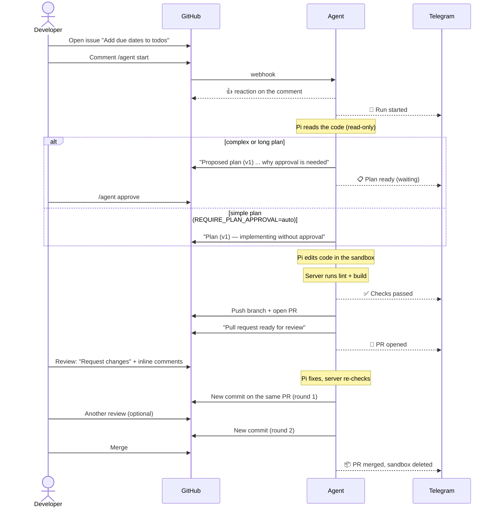
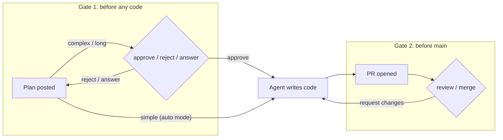

# 2. מסע המשתמש

> **מה המשתמש רואה:** הכול קורה בתגובות על ה־Issue וה־PR. אין ממשק נוסף ללמוד. מי שרוצה לראות את כל התמונה פותח את הדשבורד ב־`/dashboard` ([08](08-observability.md)).

## המסלול המלא

## הפקודות

כל פקודה היא תגובה על ה־Issue. רק משתמשים שמופיעים ב־`AUTHORIZED_GITHUB_USERS` יכולים להפעיל את הסוכן.

| פקודה | מתי | מה קורה |
|-------|-----|---------|
| `/agent start` | על Issue חדש | פותח run: תכנון, ואז אישור לפי `REQUIRE_PLAN_APPROVAL` (ראו בהמשך) |
| `/agent start auto` | כשסומכים על הסוכן במשימה | מדלג על אישור התוכנית. שאלות הבהרה עדיין עוצרות |
| `/agent approve` | אחרי שהתוכנית פורסמה | מתחיל לכתוב קוד |
| `/agent reject <reason>` | התוכנית לא טובה | הסוכן מתכנן מחדש עם הסיבה |
| `/agent answer <text>` | הסוכן שאל שאלה | התשובה נכנסת להחלטות, והסוכן ממשיך |
| `/agent stop` | בכל שלב | עוצר את ה־run, כולל Pi שרץ באותו רגע |

ל־`approve`, `answer` ו־`reject` אפשר להוסיף מזהה בקשה (למשל `/agent approve a1b2c3d4-p1-a`). בלי מזהה, הפקודה הולכת לבקשה שממתינה ב־Issue.

## שתי נקודות ההחלטה של האדם

- **שער 1** חוסך זמן: אם הסוכן הבין לא נכון, עוצרים אותו לפני שכתב קוד. מתי השער פעיל נקבע ב־`REQUIRE_PLAN_APPROVAL` (ראו בהמשך). עם `/agent start auto` מוותרים עליו לריצה אחת ומסתמכים על שער 2.
- **שער 2** תמיד קיים: הסוכן לא ממזג. גם reviews נכנסים לעבודה רק ממשתמשים מורשים.

## מתי הסוכן מחכה לאישור

| `REQUIRE_PLAN_APPROVAL` | מתי שער 1 פעיל |
|---|---|
| `true` (ברירת מחדל) | תמיד |
| `auto` | רק כשהשינוי מורכב |
| `false` | אף פעם |

במצב `auto`, ‏Pi מדרג כל תוכנית כ־`simple` או `complex` ומוסיף משפט הסבר:

- **‏`simple`:** שינוי אחד, קטן ומוגדר באזור אחד, עם דרך ברורה. בלי תלות חדשה, בלי שינוי בפורמט הנתונים ובלי הסרת התנהגות. תוכנית כזו רצה מיד, והתגובה ב־Issue מסבירה למה.
- **‏`complex`:** כמה פיצ'רים או דרישות, שינוי בכמה אזורים, תלות חדשה, שינוי בנתונים או בשמירה, או החלטת מוצר. התוכנית ממתינה ל־`/agent approve`, והתגובה מסבירה למה נדרש אישור.
- **כשיש ספק** Pi מדרג `complex`.
- **בדיקה בקוד:** תוכנית עם יותר מ־`AUTO_APPROVE_MAX_STEPS` צעדים (ברירת מחדל 4) תמיד ממתינה לאישור, גם אם Pi דירג אותה `simple`.

## כמה סבבי review

אחרי שה־PR נפתח, כל review עם **Request changes** או **Comment** פותח סבב: Pi מתקן, השרת מריץ בדיקות, ו־commit חדש נדחף לאותו PR. אפשר לחזור על זה כמה פעמים שרוצים, עד המיזוג. בדשבורד כל סבב מופיע בנפרד (Round 1, Round 2…), עם ההערות, העבודה של Pi והעלות שלו.

## מה הסוכן יכול לשאול

אם Pi נתקל בהחלטה שמשנה את התנהגות המוצר, הוא מחזיר `needs_input` במקום לנחש. זה קורה בכל אחד ממצבי האישור, גם ב־`false`. בחירות טכניות רגילות הוא אמור להסיק מהקוד. השאלה מתפרסמת כתגובה, וה־run מחכה. בזמן ההמתנה ה־sandbox מושהה ולא עולה כסף.
