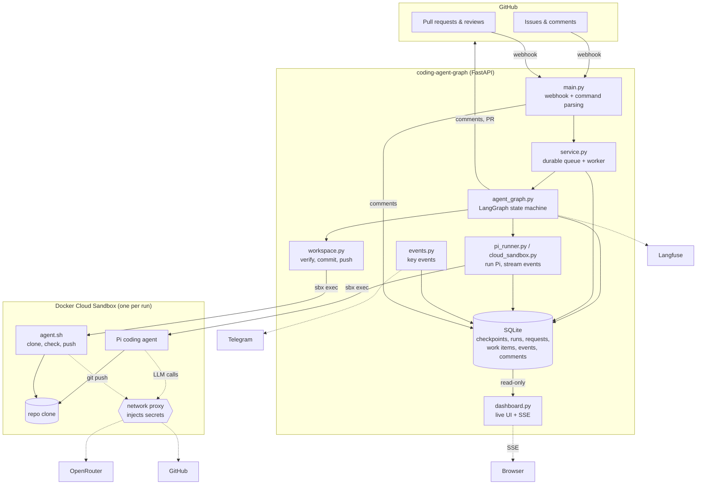

# 3. Architecture

> **In short:** one server orchestrates. LangGraph decides what happens next, Pi writes the code inside a sandbox, and SQLite remembers everything.

## Components

## What each part does

| File | Responsibility |
|------|----------------|
| [main.py](../coding-agent-graph/main.py) | Receives webhooks, verifies the signature (can be disabled for development with `WEBHOOK_VERIFY_SIGNATURE=false`), stores every comment and review in the `comments` table, filters out irrelevant events (bots, comments without `/agent`) and parses the command. |
| [commands.py](../coding-agent-graph/commands.py) | Parses `/agent ...` into an `AgentCommand`. |
| [service.py](../coding-agent-graph/service.py) | Checks authorization, stores the work item in SQLite and returns `202`. A single worker processes the queue and drives the graph. |
| [agent_graph.py](../coding-agent-graph/agent_graph.py) | The graph: loading the Issue, planning, deciding whether approval is needed, waiting for a person, implementing, checks and the PR. See [04](04-state-graph.md). |
| [pi_runner.py](../coding-agent-graph/pi_runner.py) | Runs Pi, reads its event stream (JSONL), enforces timeout and stop, and extracts the structured result. |
| [cloud_sandbox.py](../coding-agent-graph/cloud_sandbox.py) | The same interface over `sbx --cloud`: creating, starting, pausing and deleting a sandbox, and retrying on network errors. |
| [workspace.py](../coding-agent-graph/workspace.py) | Checks the diff and runs `npm run lint` and `npm run build`, then commits and pushes. |
| [sandbox/agent.sh](../coding-agent-graph/sandbox/agent.sh) | The script that runs inside the sandbox: `setup`, `check`, `commit-push`, `pi`, `stop-pi`. |
| [pi_extensions/submit_result.ts](../coding-agent-graph/pi_extensions/submit_result.ts) | The tool Pi uses to submit its result in a fixed schema instead of free text. While planning it also carries `complexity` and `complexity_reason`. |
| [graph_view.py](../coding-agent-graph/graph_view.py) | Draws the graph from LangGraph and marks a run's progress on it. Served at `/graph`. |
| [events.py](../coding-agent-graph/events.py) | Key events: stored in SQLite, written to the log and sent to Telegram. |
| [dashboard.py](../coding-agent-graph/dashboard.py) + [dashboard.html](../coding-agent-graph/dashboard.html) | The dashboard at `/dashboard`: merges all tables into one timeline per run, computes stages and costs, and pushes changes to the browser over SSE. See [08](08-observability.md). |
| [storage.py](../coding-agent-graph/storage.py) | All tables: `runs`, `requests`, `work_items`, `deliveries`, `pi_events`, `events`, `comments`, `telegram_topics`. |

## Two execution modes

| | `EXECUTION_MODE=local` | `EXECUTION_MODE=cloud` |
|---|---|---|
| Where Pi runs | On the local machine, in a git worktree | In a Docker Cloud Sandbox |
| Where the code comes from | An existing local clone | `gh repo clone` inside the sandbox |
| Who pushes | The server, with its token | The sandbox, through the proxy |
| Isolation | Filtered environment variables | Separate VM, blocked network, secrets outside the sandbox |

Both modes go through the same interface (`WorkspaceManager` and `PiRunner`), so the graph doesn't know which mode it runs in.

## Why LangGraph

A run lasts hours or even days, because it waits for people. LangGraph provides:
- **`interrupt()`**: the graph stops in the middle of a node, is saved to SQLite, and lets go. No process sits waiting.
- **`Command(resume=...)`**: when a reply arrives, the graph continues from exactly the same point, even after a server restart.
- **A thread per run**: the `thread_id` ties together the checkpoints of one run.
