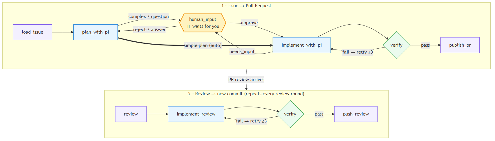
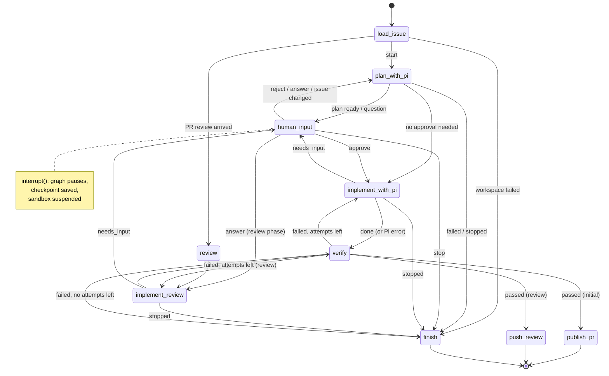
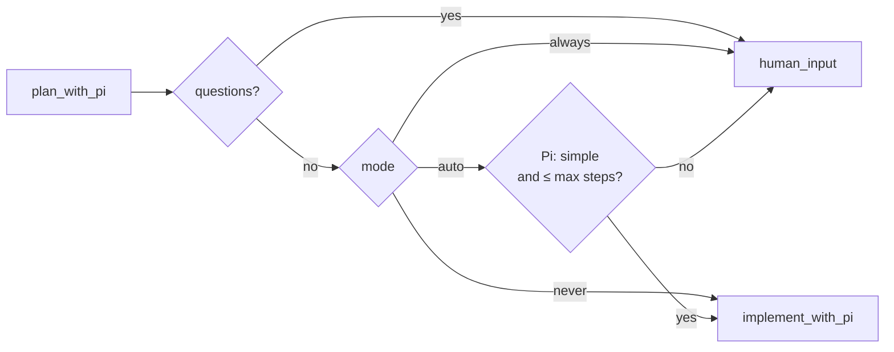
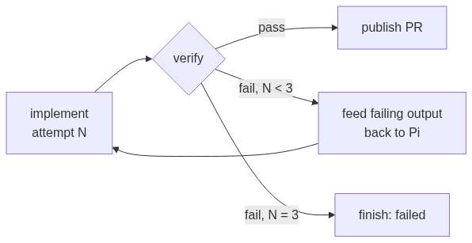
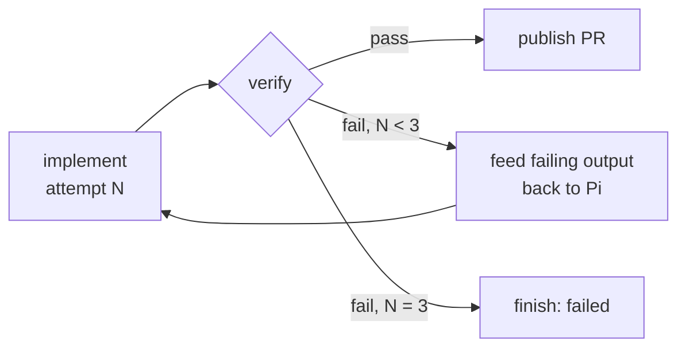

# 4. The state graph

> **In short:** every run is a walk between nodes. The graph saves a checkpoint at every node, and at decision points it stops until a person replies.

## In one picture (for a slide)

Blue: Pi is working. Yellow: the graph stops and waits for a person. Green: the server runs checks. Purple: work against GitHub. The thick arrow is a simple plan in `auto` mode, which skips approval. The lower part repeats for every review round. Exits to `finish` (failure or stop) are omitted. Source: [graph-slide.mmd](graph-slide.mmd).

## The graph

This diagram is drawn by hand and explains the transitions. The version generated from the code is in [langgraph.md](langgraph.md), and the live version is at the server's `/graph` (see [08](08-observability.md)).

## The nodes

| Node | What it does | Pi's tools |
|------|--------------|------------|
| `load_issue` | Loads the Issue and its comments, computes `requirements_version` (a hash of the requirements), and creates the branch and sandbox. | — |
| `plan_with_pi` | Pi explores the code and submits a plan, questions or a failure, plus a `simple`/`complex` rating. This is where the plan either goes straight to implementation or waits for approval (see below). | `read, grep, find, ls` |
| `human_input` | Posts the plan or question as a comment and stops (`interrupt`). When a reply arrives, it is recorded in `decisions`. | — |
| `implement_with_pi` | Pi implements the approved plan. On a retry it gets the output of the failed checks. | `read, bash, edit, write, grep, find, ls` |
| `verify` | The server checks that the changes stay inside the allowed folder and runs lint and build. | — |
| `publish_pr` | Checks that the code hasn't changed since it was verified, then commits, pushes and opens the PR. | — |
| `review` | Loads the review summary and its inline comments. | — |
| `implement_review` | Pi fixes according to the review, in the same sandbox and session. | Same as implementation |
| `push_review` | Another commit on the same PR. | — |
| `finish` | Summary comment: status, changed files and checks. | — |

## When a plan skips approval

After `plan_with_pi`, `_approval_decision` decides according to `REQUIRE_PLAN_APPROVAL`:

The decision and its reason are kept in the state (`auto_approve`, `approval_reason`), and the reason appears in the Issue comment. The step limit (`AUTO_APPROVE_MAX_STEPS`) is checked in code and doesn't depend on Pi's rating.

## The fix loop

`AGENT_MAX_ATTEMPTS` (default 3) limits the number of attempts. On each attempt Pi gets the last 2,000 characters of output from every failed check, and continues in the same session, so it remembers what it already tried.

## Safeguards built into the graph

- **Changed requirements:** if the Issue is edited while the plan waits for approval, `approve` becomes `requirements_changed` and the agent re-plans.
- **Stale approval:** an approval for an older plan version is rejected ("That approval is for an old plan version").
- **Code changed after verification:** `publish_pr` and `push_review` compare the revision (a hash of HEAD and the files) with what was verified. If they differ, they re-run the checks or refuse.
- **Review without changes:** if Pi "fixed" a review without changing any code, verification fails.
