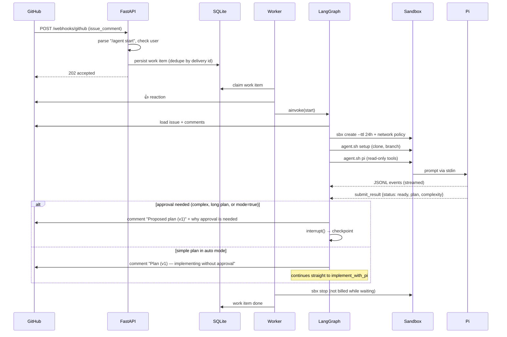
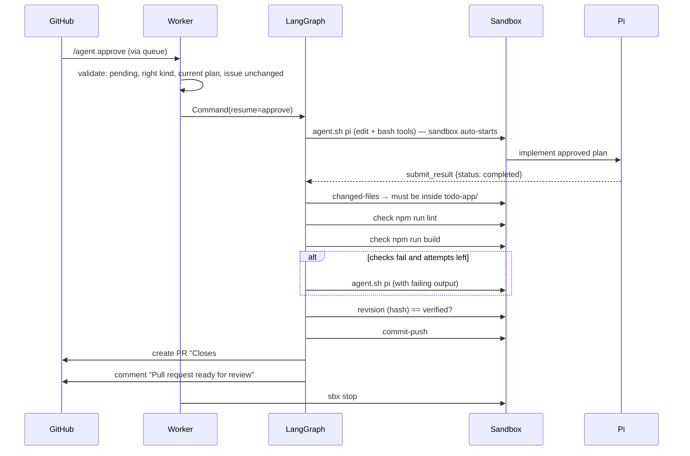
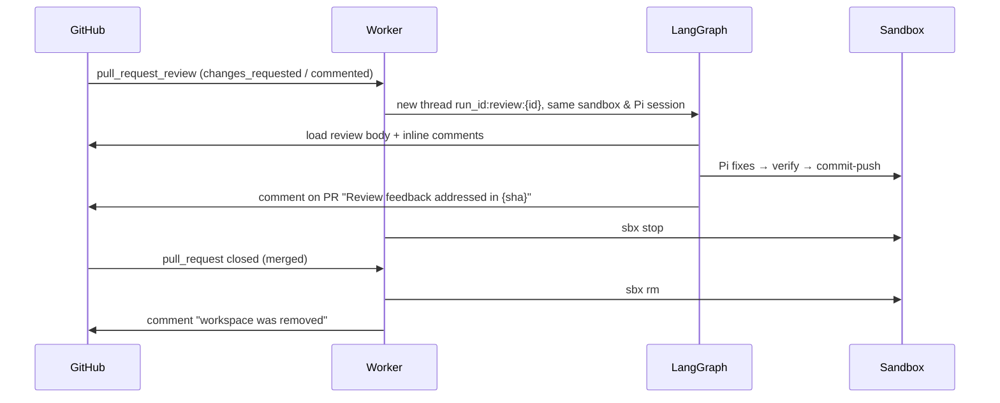

# 5. End-to-end run

> **In short:** every webhook becomes a stored work item. The worker runs the graph until it stops, pauses the sandbox, and lets go.

## From `/agent start` to a plan

## From approval to PR

## Review and merge

## How Pi returns a result

Pi doesn't finish with free text. It calls the `submit_result` tool, which:
- Enforces a schema: `status`, `summary`, `plan`, `questions`, `claimed_checks`, and while planning also `complexity` and `complexity_reason`.
- Limits the statuses by phase: `ready | needs_input | failed` while planning, `completed | needs_input | failed` while implementing.
- Returns `terminate: true`, so there is no wasted LLM turn after the submission.

The server reads the result from the `tool_execution_end` event. Extracting JSON from text remains only as a fallback for models that don't call the tool.
