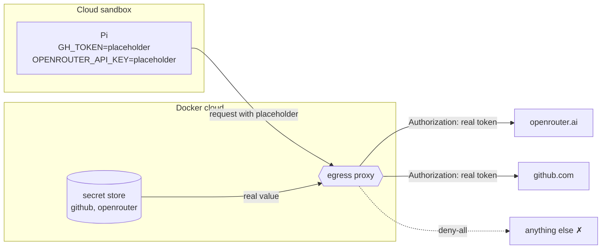
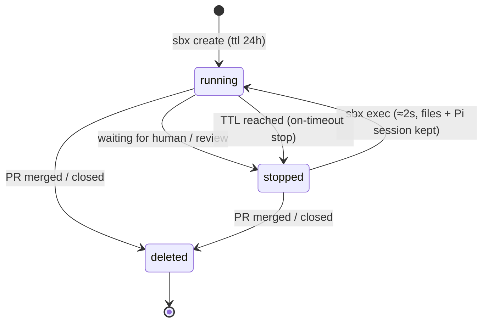

# 6. Sandbox and security

> **In short:** the agent writes and runs code, but inside a cloud VM, without secrets, with a blocked network, and with no ability to push or merge on its own.

## Where the secrets live

- Secrets are stored once in Docker's secret store (`sbx --cloud secret set ...`).
- Inside the sandbox there are only placeholder values. Even if Pi prints its environment variables, it never sees a real key.
- The proxy swaps the placeholder for the real value only on requests to allowed hosts.

## Layers of protection

| Layer | What it prevents |
|-------|------------------|
| **A separate VM per run** | One run can't see another run's files or the local machine. |
| **`deny-all` network** | Pi can't send code or data to an unknown server. Only the Kit's hosts and `SANDBOX_ALLOW_NETWORK` are allowed. |
| **Tools per phase** | While planning, Pi gets only `read, grep, find, ls`. Editing and shell come only after approval, or in `auto` mode after a simple plan. |
| **Folder boundary** | `verify` rejects any change outside `todo-app/`. Pi can't change the workflow, the agent itself or the CI. |
| **The server checks, not Pi** | Lint and build run from the server. What Pi "claims it checked" (`claimed_checks`) has no effect. |
| **The server decides when to push** | Push happens only after the checks pass, and only if the revision matches the one that was verified. |
| **No merging** | The agent opens a PR and never merges. Branch protection on `main` is recommended. |
| **Webhook signature** | Every request is checked with HMAC-SHA256 against `GITHUB_WEBHOOK_SECRET`. Without a valid signature: `401`. With no secret configured, the server refuses every webhook. For development the check can be turned off with `WEBHOOK_VERIFY_SIGNATURE=false`, and then anyone who knows the tunnel address can send commands. Set it back to `true` before real exposure. |
| **Authorized users** | Commands and reviews only from `AUTHORIZED_GITHUB_USERS`. Bot comments are filtered out. |
| **Redaction** | Tokens and keys are replaced with `[REDACTED]` in logs, SQLite and Telegram. |

## Sandbox lifecycle

A stopped sandbox costs nothing. Files and the Pi session are kept, so an approval that arrives a day later continues from the same point.

## Known gaps (demo stage)

- **The GitHub token can push.** Use a fine-grained PAT for a single repository, together with branch protection.
- **The agent reads Issue content.** Anyone who can write an Issue can attempt prompt injection. Isolation and the server-side checks limit the damage, and human review is the last line of defense.
