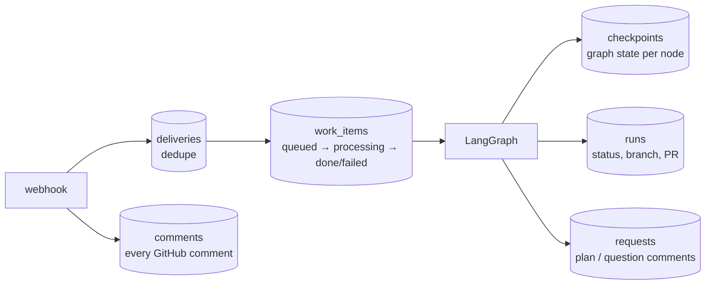

# 7. Reliability

> **In short:** everything that happens is saved to SQLite first and only then executed. You can kill the server at any moment, and it continues where it left off.

## What is stored where

| Table | What it guarantees |
|-------|--------------------|
| `deliveries` / `work_items` | A webhook delivered twice (GitHub retries) is processed once. `202` is returned only after the item is saved. |
| LangGraph checkpoints | The graph continues from the last completed node, not from the start. |
| `runs` | One active run per Issue, and a PR → run mapping for reviews. |
| `requests` | Every comment the agent posts gets an ID and a hash. If the graph re-runs the same node, the comment is not posted twice. |
| `comments` | Every comment, review and inline comment is stored once (key: type + GitHub ID), even if the webhook arrives again. On startup the server fills in from GitHub any comments it missed while it was down. |

## Failure scenarios

| What happened | What the system does |
|---------------|----------------------|
| The server crashed mid-run | On startup, items in `queued` or `processing` state go back on the queue. The graph continues from the checkpoint. |
| It crashed after the approval was recorded, before the work finished | `_continue_interrupted_run` notices the request is already resolved but the graph is mid-step, and continues it. |
| Unexpected error | Up to 3 attempts per work item. After that it is marked `failed`, and a comment is posted on the Issue along with a `🔥` notification. |
| Pi hangs | `PI_TIMEOUT_SECONDS` (default 900) kills it, including the process inside the sandbox. |
| `/agent stop` while Pi is running | The run is marked `stop_requested`. `PiRunner` checks this every second, kills Pi and runs `pkill -x pi` in the sandbox. |
| Network error talking to Docker | `sbx` retries after 3, 10 and 30 seconds, and only for errors that happen before the request reached the sandbox. |
| Sandbox in the middle of stopping | Wait for it to settle (up to 5 minutes), then retry. |
| Checks failed | Up to 3 implementation attempts, each one given the failing output. |
| Telegram unavailable | Delivery runs in a background queue and never blocks the run. The event stays in SQLite. |

## Design considerations

- **A single worker:** simple and safe (no two runs compete over the same Issue), but Issues wait for each other. It can be extended to N workers with a per-Issue lock.
- **No `--reload`:** changes to local files (SQLite, worktrees) would trigger a restart and kill a run mid-way.
