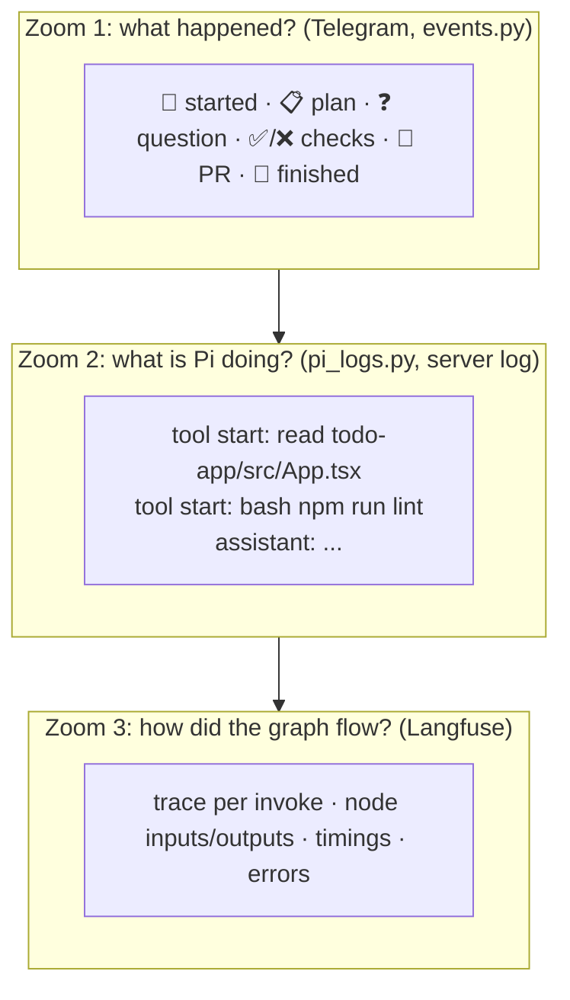

# 8. Observability

> **In short:** the dashboard at `/dashboard` shows everything in one place, in real time: each run's flow, every comment, and what every stage cost. Beneath it are three zoom levels: Telegram for key events, `pi_logs.py` for every action Pi takes, and Langfuse for every step through the graph. In addition, `/graph` shows where each run is in the graph.

## Three levels



## 0. The live dashboard: `/dashboard`

The server serves a dashboard at `http://localhost:8000/dashboard`. It reads straight from SQLite and updates in real time: the server checks every second for new rows and pushes a change to the browser over Server-Sent Events (`/api/stream`).

- **Run list:** every Issue and PR with its status, cost, comment count and a progress bar. Filter by Active, Needs you, Done and Failed, or search.
- **Flow:** Triggered → Plan → Approval → Implement → Verify → PR → Review → Done, with the duration and cost of each stage. The current stage pulses, in yellow when it is waiting for you. A skipped stage (for example the approval of a simple plan) is marked skipped. A counter over a stage shows how many times it happened: review rounds, checks, or Pi sessions.
- **Cost breakdown:** per phase (planning, implementation, review fixes), with tokens and time. The cost comes from the `usage.cost` of every Pi message.
- **Timeline:** commands, comments (yours and the agent's, including reviews and inline comments), plans and approvals (including how long they waited for you), key events and Pi sessions. Each review round appears separately (Round 1, Round 2…). "Show every step" expands every tool call of a session.

Data sources:

| What is shown | Table |
|---|---|
| Runs and status | `runs` |
| Commands | `work_items` |
| Plans, questions and answers | `requests` |
| Key events | `events` |
| Pi: tools, messages, costs | `pi_events` |
| GitHub comments | `comments` |

The agent stores its own comments the moment it posts them, and the webhook stores everything else. That's why the webhook must also include **Pull request review comments**. On startup the server fills in comments and titles of recent runs from GitHub.

To browse without running the agent (read-only, `/graph` included):

```bash
python dashboard.py --backfill    # pull comments from GitHub first, then serve on :8090
python dashboard.py
```

If the server is exposed through a tunnel, the dashboard and its API are exposed too, with no authentication.

## 1. Key events and Telegram

[events.py](../coding-agent-graph/events.py) collects the events a person wants to know about:

| | Event | | Event |
|---|---|---|---|
| 🚀 | Run started | ✅ | Checks passed |
| 📋 | Plan ready | ❌ | Checks failed (with output) |
| ❓ | Waiting for an answer | 🔀 | PR opened |
| 🆕 🟢 ⏸️ 🗑️ | Sandbox created, started, stopped, deleted | ⬆️ | Review fixes pushed |
| 🔁 | Docker retry | 🏁 | Run finished |
| 📝 | Review received | 📦 | PR merged or closed |
| 🔥 | Work item failed for good | | |

In a Telegram group with Topics, every Issue gets its own Topic, so each task's timeline stays separate.

```bash
python events.py --follow             # live
python events.py --run-id d83d7e04    # one run's timeline
```

## 2. What Pi is doing

Every Pi event (tool start and end, reply, retry, compaction) is stored in the `pi_events` table and printed to the server log:

```text
INFO pi [run=12ab34cd phase=plan] tool start: read {"path":"todo-app/src/App.tsx"}
INFO pi [run=12ab34cd phase=implement] tool start: bash {"command":"npm run lint"}
```

```bash
python pi_logs.py --follow --run-id 12ab34cd
```

## 3. Langfuse

Every invocation or resume of the graph is a trace named `coding-agent:<action>`, and all the traces of a run are grouped in a session by `run_id`. You can filter by repository, Issue and action, and see each node's input and output and its timings.

## 4. The live graph: `/graph`

The server serves the LangGraph graph as a page: `http://localhost:8000/graph`. The diagram is generated from the compiled graph itself (`get_graph().draw_mermaid()`), so it always matches the code.

- **Without parameters:** the graph, and a list of recent runs.
- **`/graph?run_id=d83d7e04`:** the same graph, colored for that run: green = nodes that already ran, yellow = the current node (or the one where the run waits for a person). The page refreshes every 5 seconds, so you can keep it on screen during a demo.

Progress is read from LangGraph's checkpoints in SQLite. If the server is exposed through a tunnel, this page is exposed too, and repository names and Issue numbers are visible on it.

```bash
python graph_view.py                          # print the Mermaid diagram
python graph_view.py --write ../docs/langgraph.md
```

## Inspecting a sandbox by hand

```bash
sbx --cloud ls                                     # all sandboxes
sbx --cloud exec -it agent-issue-12-ab12cd34 bash  # look around, git diff
sbx --cloud policy log agent-issue-12-ab12cd34     # blocked network requests
```
