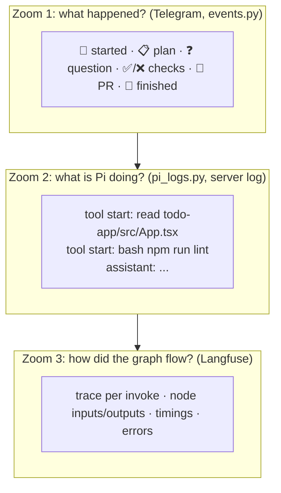

# 8. נראות

> **בקצרה:** הדשבורד ב־`/dashboard` מראה הכול במקום אחד ובזמן אמת: הפלאו של כל run, כל הערה, וכמה עלה כל שלב. מתחתיו שלוש רמות זום: Telegram לאירועי מפתח, `pi_logs.py` לכל פעולה של Pi, ו־Langfuse לכל מעבר בגרף. ובנוסף, `/graph` מראה איפה כל run נמצא בגרף.

## שלוש רמות



## 0. הדשבורד החי: `/dashboard`

השרת מגיש דשבורד בכתובת `http://localhost:8000/dashboard`. הוא נקרא ישירות מ־SQLite ומתעדכן בזמן אמת: השרת בודק כל שנייה אם נוספו שורות, ודוחף שינוי לדפדפן ב־Server-Sent Events (`/api/stream`).

- **רשימת runs:** כל Issue ו־PR עם סטטוס, עלות, מספר הערות ופס התקדמות. סינון לפי Active, ‏Needs you, ‏Done ו־Failed, וחיפוש.
- **פלאו:** ‏Triggered → Plan → Approval → Implement → Verify → PR → Review → Done. לכל שלב משך ועלות. השלב הנוכחי מהבהב, ובצהוב כשהוא מחכה לך. שלב שדולג (למשל אישור של תוכנית פשוטה) מסומן skipped. מונה מעל שלב מראה כמה פעמים הוא קרה: סבבי review, בדיקות, או סשנים של Pi.
- **פירוט עלויות:** לפי phase (planning, ‏implementation, ‏review fixes), עם טוקנים וזמן. העלות מגיעה מ־`usage.cost` שבכל הודעה של Pi.
- **ציר זמן:** פקודות, הערות (שלך ושל הסוכן, כולל reviews והערות inline), תוכניות ואישורים (כמה זמן חיכו לך), אירועי מפתח וסשנים של Pi. כל סבב review מופיע בנפרד (Round 1, Round 2…). ‏"Show every step" פותח את כל קריאות הכלים של סשן.

מקורות הנתונים:

| מה מוצג | טבלה |
|---|---|
| ריצות וסטטוס | `runs` |
| פקודות | `work_items` |
| תוכניות, שאלות ותשובות | `requests` |
| אירועי מפתח | `events` |
| Pi: כלים, הודעות, עלויות | `pi_events` |
| הערות GitHub | `comments` |

הסוכן שומר את ההערות שלו ברגע שהוא שולח אותן, וה־webhook שומר את כל השאר. לכן ה־webhook צריך לכלול גם **Pull request review comments**. בעליית השרת הוא משלים מ־GitHub הערות וכותרות של ה־runs האחרונים.

לצפייה בלי להריץ את הסוכן (קריאה בלבד, כולל `/graph`):

```bash
python dashboard.py --backfill    # pull comments from GitHub first, then serve on :8090
python dashboard.py
```

אם השרת חשוף דרך tunnel, גם הדשבורד וה־API שלו חשופים, בלי אימות.

## 1. אירועי מפתח ו־Telegram

[events.py](../coding-agent-graph/events.py) מרכז את האירועים שבן אדם רוצה לדעת עליהם:

| | אירוע | | אירוע |
|---|---|---|---|
| 🚀 | run התחיל | ✅ | בדיקות עברו |
| 📋 | תוכנית מוכנה | ❌ | בדיקות נכשלו (עם הפלט) |
| ❓ | ממתין לתשובה | 🔀 | PR נפתח |
| 🆕 🟢 ⏸️ 🗑️ | sandbox נוצר, הופעל, נעצר, נמחק | ⬆️ | תיקוני review נדחפו |
| 🔁 | ניסיון חוזר מול Docker | 🏁 | run הסתיים |
| 📝 | review התקבל | 📦 | PR מוזג או נסגר |
| 🔥 | פריט עבודה נכשל סופית | | |

בקבוצת Telegram עם Topics, כל Issue מקבל Topic משלו, כך שה־timeline של כל משימה נשאר נפרד.

```bash
python events.py --follow             # live
python events.py --run-id d83d7e04    # one run's timeline
```

## 2. מה Pi עושה

כל אירוע של Pi (התחלה וסיום של כלי, תשובה, retry, compaction) נשמר בטבלה `pi_events` ומודפס ללוג של השרת:

```text
INFO pi [run=12ab34cd phase=plan] tool start: read {"path":"todo-app/src/App.tsx"}
INFO pi [run=12ab34cd phase=implement] tool start: bash {"command":"npm run lint"}
```

```bash
python pi_logs.py --follow --run-id 12ab34cd
```

## 3. ‏Langfuse

כל הפעלה או המשך של הגרף היא trace בשם `coding-agent:<action>`, וכל ה־traces של run מקובצים ב־session לפי `run_id`. אפשר לסנן לפי repository, ‏Issue ו־action, ולראות את הקלט והפלט של כל node ואת זמני הריצה.

## 4. הגרף החי: `/graph`

השרת מגיש את גרף ה־LangGraph כדף: `http://localhost:8000/graph`. הדיאגרמה נוצרת מהגרף המקומפל עצמו (`get_graph().draw_mermaid()`), ולכן תמיד תואמת לקוד.

- **בלי פרמטרים:** הגרף, ורשימת ה־runs האחרונים.
- **‏`/graph?run_id=d83d7e04`:** אותו גרף, עם צביעה של ה־run: ירוק = nodes שכבר רצו, צהוב = ה־node הנוכחי (או זה שבו ה־run מחכה לאדם). הדף מתרענן כל 5 שניות, כך שאפשר להשאיר אותו פתוח במסך בזמן דמו.

ההתקדמות נקראת מה־checkpoints של LangGraph ב־SQLite. אם השרת חשוף דרך tunnel, גם הדף הזה חשוף, ואפשר לראות בו שמות repositories ומספרי Issues.

```bash
python graph_view.py                          # print the Mermaid diagram
python graph_view.py --write ../docs/langgraph.md
```

## למעקב ידני ב־sandbox

```bash
sbx --cloud ls                                     # all sandboxes
sbx --cloud exec -it agent-issue-12-ab12cd34 bash  # look around, git diff
sbx --cloud policy log agent-issue-12-ab12cd34     # blocked network requests
```
